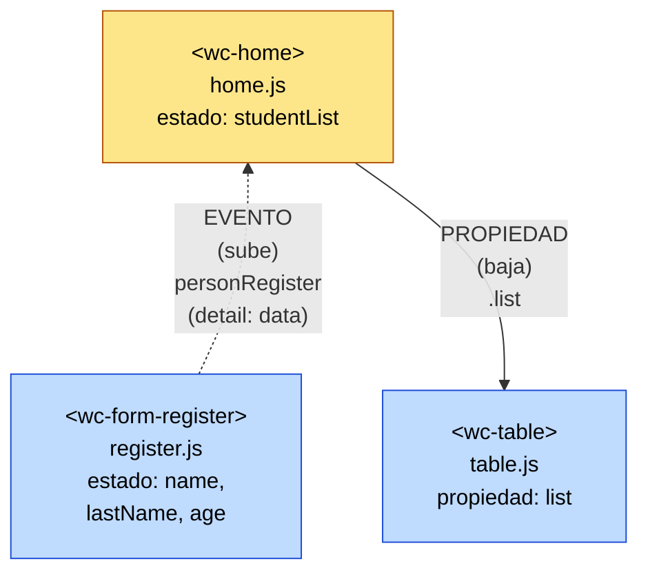
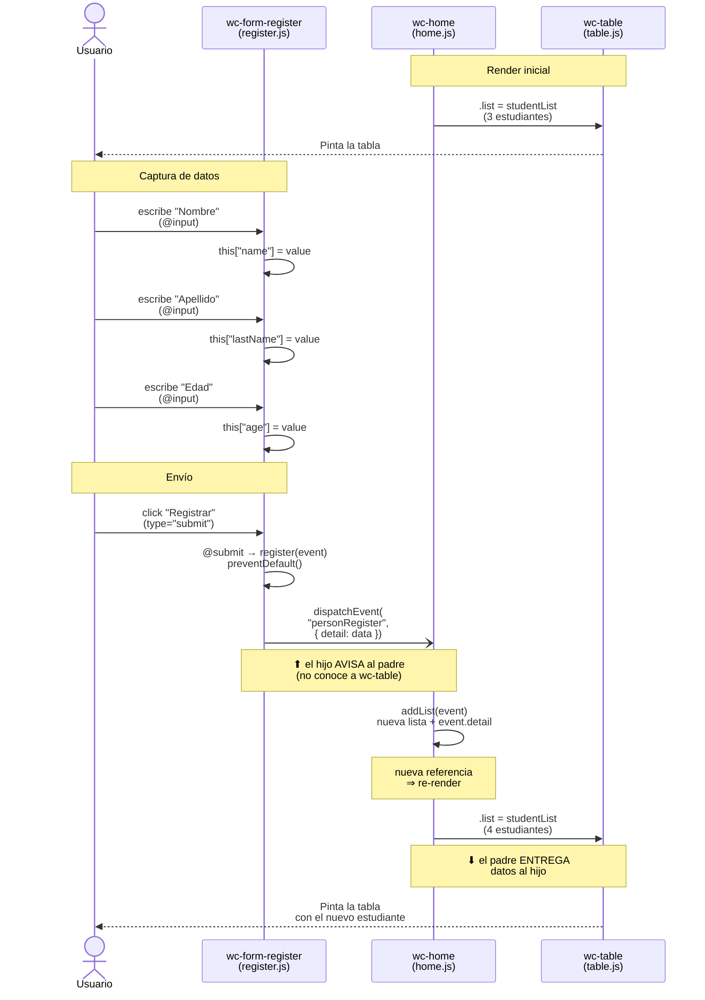
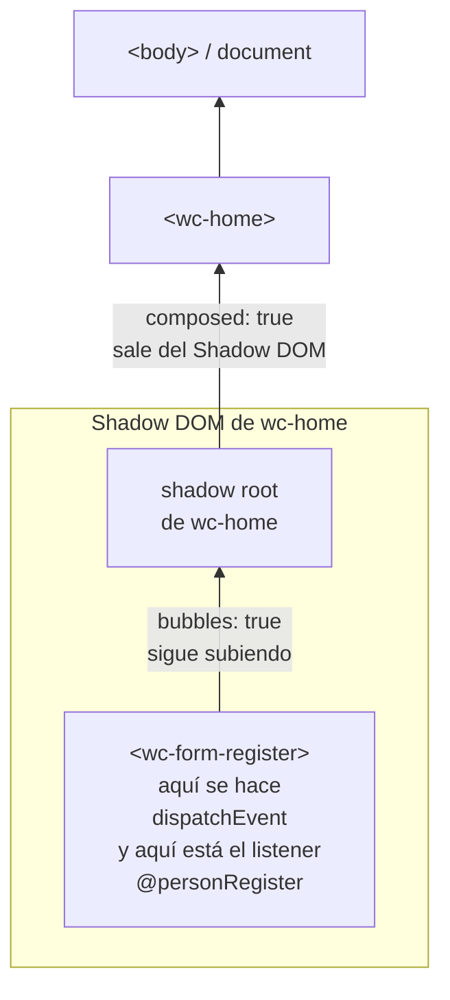

# Flujo de comunicación entre componentes

Componentes involucrados (directorio `src/views/home/`):

| Componente | Archivo | Rol |
|---|---|---|
| `<wc-home>` | `home.js` | **Padre**. Dueño del estado `studentList`. |
| `<wc-form-register>` | `register.js` | **Hijo**. Captura los datos y **emite** un evento. |
| `<wc-table>` | `table.js` | **Hijo**. **Recibe** la lista por propiedad y la pinta. |

> Regla de oro: **los datos bajan por propiedades** (padre → hijo) y **los avisos suben por eventos** (hijo → padre).
> Los hermanos (`form` y `table`) **nunca** se hablan directamente: siempre pasan por el padre.

---

## 1. Vista general (árbol de componentes)



- Flecha sólida **hacia abajo** = paso de datos por **propiedad** (`.list`).
- Flecha punteada **hacia arriba** = comunicación por **evento** (`dispatchEvent`).

---

## 2. Flujo paso a paso (diagrama de flujo)

```mermaid
%%{init: {"flowchart": {"htmlLabels": true, "wrappingWidth": 600, "padding": 20, "nodeSpacing": 60, "rankSpacing": 60}}}%%
flowchart TD
    A(["Usuario escribe<br/>en un input"]) --> B["@input ejecuta<br/>handler('name')<br/>handler('lastName')<br/>handler('age')"]
    B --> C["this[name] =<br/>event.target.value"]
    C --> D["Lit re-renderiza<br/>el formulario"]
    D --> E{"¿Pulsa<br/>Registrar?"}
    E -- No --> A
    E -- Sí --> F{"¿Pasa la<br/>validación?<br/>(required, min)"}
    F -- No --> G["El navegador<br/>muestra el aviso.<br/>No hay submit"] --> A
    F -- Sí --> H["&lt;form @submit&gt;<br/>ejecuta<br/>register(event)"]
    H --> I["event.preventDefault()<br/>(no recarga la página)"]
    I --> J["data = {<br/>name, lastName, age<br/>}"]
    J --> K["this.dispatchEvent(<br/>new CustomEvent(<br/>'personRegister',<br/>{ detail: data,<br/>bubbles: true,<br/>composed: true }))"]

    K ==>|"EVENTO<br/>(sube al padre)"| L["&lt;wc-home&gt; escucha<br/>@personRegister"]
    L --> M["addList(event)<br/>lee event.detail"]
    M --> N["Copia el arreglo<br/>y hace push(<br/>event.detail)"]
    N --> O["this.studentList =<br/>newList<br/>(nueva referencia)"]
    O --> P["Lit re-renderiza<br/>&lt;wc-home&gt;"]

    P ==>|"PROPIEDAD<br/>(baja al hijo)"| Q["&lt;wc-table&gt;<br/>recibe .list<br/>actualizada"]
    Q --> R["this.list.map(...)<br/>una fila por<br/>estudiante"]
    R --> S(["La tabla muestra<br/>el nuevo estudiante"])

    classDef form fill:#bfdbfe,stroke:#1d4ed8,color:#000
    classDef home fill:#fde68a,stroke:#b45309,color:#000
    classDef table fill:#bbf7d0,stroke:#15803d,color:#000
    class B,C,D,H,I,J,K form
    class L,M,N,O,P home
    class Q,R table
```



Colores: 🔵 `register.js` · 🟡 `home.js` · 🟢 `table.js`

---

## 3. Secuencia en el tiempo (quién habla con quién)



---

## 4. Conceptos clave

### Propiedad (padre → hijo)
```js
// home.js (padre)
html`<wc-table .list="${this.studentList}"></wc-table>`
```
- El **punto** (`.list`) asigna directamente la **propiedad JS** del elemento: `tableEl.list = this.studentList`.
- Sirve para pasar **objetos y arreglos** tal cual (sin convertirlos a texto, como pasaría con un atributo `list="..."`).
- Cada vez que `studentList` cambia, `<wc-home>` se re-renderiza y vuelve a entregar la lista a `<wc-table>`.

### Evento (hijo → padre)
```js
// register.js (hijo)
this.dispatchEvent(new CustomEvent("personRegister", {
  detail: data,   // los datos que viajan con el evento
  bubbles: true,  // el evento sube por el árbol DOM
  composed: true, // y puede atravesar el límite del Shadow DOM
}));
```
```js
// home.js (padre)
html`<wc-form-register @personRegister="${this.addList}"></wc-form-register>`
addList(event) { /* event.detail === data */ }
```
- `detail` es **la única** clave donde viajan datos en un `CustomEvent` (por eso `event.data` no existía).
- `@personRegister` equivale a `formEl.addEventListener("personRegister", this.addList)`, con `this` ya enlazado a `<wc-home>`.

### ¿Qué hacen exactamente `bubbles` y `composed`?



- En este proyecto el listener está **directamente sobre** `<wc-form-register>`, por eso el evento llega a `addList` aun sin `bubbles`.
- `bubbles` + `composed` son útiles si un **ancestro más lejano** (por ejemplo, un componente que envuelva a `<wc-home>`) también quiere escuchar `personRegister`.

### Reactividad: por qué hay que crear un arreglo nuevo
```js
let newList = Object.assign([], this.studentList); // copia (nueva referencia)
newList.push(event.detail);
this.studentList = newList;                        // Lit compara referencias ⇒ re-render
```
Si se hiciera `this.studentList.push(...)` sobre el mismo arreglo, la referencia no cambia y **Lit no re-renderiza** la tabla.

---

## 5. Resumen en una línea

**Usuario → `@input` (form actualiza su estado) → `@submit` → `dispatchEvent` ⬆ → `home.addList` actualiza `studentList` → re-render → `.list` ⬇ → `table` pinta la fila nueva.**
